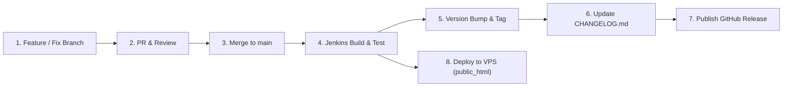

# Changelog

All notable changes to the **Sri Lanka Air Force (SLAF) Trade Training School (TTS) Management Portal** are documented in this file.

The format is based on [Keep a Changelog](https://keepachangelog.com/en/1.0.0/),
and this project adheres to [Semantic Versioning 2.0.0](https://semver.org/spec/v2.0.0.html).

---

## Technology Stack Overview

| Layer | Technologies & Tools |
| :--- | :--- |
| **Frontend** | React 18, Vite 5, Bootstrap 5.3, Bootstrap Icons, Axios, React Hook Form, Zod, Chart.js, FullCalendar |
| **Backend** | Python 3.12+, FastAPI, SQLAlchemy ORM, Pydantic v2, PyJWT, Passlib (bcrypt) |
| **Database** | MySQL 8.0 (Production VPS) / SQLite (Local Standalone Development) |
| **Version Control** | Git, GitHub (`sankaadikaramNW/TTS-management-system`) |
| **CI / CD** | Jenkins (Dockerized Pipeline with automated Node.js caching & SSH/SCP deployment) |
| **Hosting & VPS** | Oracle Cloud VPS (`130.210.18.73`), Ubuntu 24.04 LTS |
| **Web Server & Reverse Proxy** | CloudPanel, NGINX (TLS/SSL, HTTP/2), systemd (`ttsmp-fastapi.service`) |
| **Media & Document Storage** | Cloudinary (Lesson Plan PDFs & Document attachments) / Local Static Mount |

---

## [Unreleased]

### Added
- **Night Parade Workflow**: Planned nocturnal muster and billet strength reconciliation stage for 24-hour accountability.
- **Biometric Device Integration**: Planned hardware reader connectivity for automated morning parade muster and gate tracking.
- **Offline PWA Capabilities**: Planned progressive web application service worker for cached offline trainee identity verification.
- **Automated Database Backup Pipeline**: Planned recurring scheduled database snapshots integrated into Jenkins / CloudPanel automated workflows.

---

## [0.9.5-rc.1] - 2026-11-10 *(Proposed Initial Release Candidate)*

### Added
- **Personal Occurrence Reporting (POR) Module**:
  - Integrated trainee achievement and disciplinary misconduct recording (`ACHIEVEMENT`, `MISCONDUCT_OFFENSE`).
  - Indexed exact-match Service Number lookup (`/api/v1/students/lookup/{service_number}`) with real-time feedback.
  - Verified trainee read-only preview card displaying rank, full name, trade, batch/intake, and active course assignment.
  - Auto-lookup fallback mechanism upon form blur and form submission if service number was typed without manual search button trigger.
  - Dual-key payload linking (`trainee_id` and `service_number`) to prevent duplicate personnel creation and maintain strict historical integrity.
  - "Change Person" re-search capability to switch personnel directly within an active modal.
- **Examination Scheduling Automation**:
  - Dependent dynamic dropdowns retrieving only actively ongoing courses (`/api/v1/academic/courses/ongoing`).
  - Automatic retrieval and binding of syllabus subjects assigned specifically to the selected course (`/api/v1/academic/courses/{id}/subjects`).
- **Unified Examination Dashboard**:
  - Merged KPI dashboard tile for **"Examinations & Tests"** computing combined phase tests and final examination counts (`upcoming_phase_tests + upcoming_final_exams`).
  - Detailed subtitle breakdown pill (`X Phase Tests • Y Final Exams`) with direct single-click navigation.
  - Single consolidated **"Examinations & Tests"** subtab and sidebar navigation item replacing separate redundant views.
  - In-table filter pill group (`All`, `Phase Tests`, `Final Exams`) with real-time count badges.
- **Automated Jenkins CI/CD Pipeline Deployment**:
  - Passwordless SSH/SCP integration from Jenkins Docker container (`172.17.0.1`) directly into production web root (`/home/itwekala-ttsmp/htdocs/ttsmp.itwekala.com.lk/public_html`).
  - Node.js archive binary caching within Jenkins workspace to eliminate redundant binary downloads on each run.
  - Automatic deployment with correct user and group permissions (`itwekala-ttsmp:itwekala-ttsmp`) and live NGINX reload.

### Changed
- **Academic Dashboard Tile Layout**:
  - Rebalanced the 9 primary ERP summary tiles to `col-6 col-md-4 col-xl-4` for a symmetrical 3×3 grid across desktop and tablet viewports.
- **Modal Viewport & Responsive Scrolling Architecture**:
  - Standardized all complex modal dialogs (`AssessmentManagement`, `PersonalOccurrenceReporting`) to use strict CSS flexbox containment (`display: flex; flex-direction: column; max-height: min(90vh, 760px)`).
  - Pinned modal headers (`position: sticky; top: 0; flex-shrink: 0`) and action footers (`position: sticky; bottom: 0; flex-shrink: 0`) within the visible viewport.
  - Internal modal body container set to `flex: 1; min-height: 0; overflow-y: auto; overscroll-behavior: contain` with native touch scrolling support.
  - Implemented background page scroll locking (`document.body.style.overflow = 'hidden'`) during modal visibility.
  - Added keyboard accessibility listener (`Escape` key modal dismissal).

### Fixed
- **JavaScript Temporal Dead Zone (TDZ) Runtime Error**:
  - Resolved `ReferenceError: Cannot access 'D' before initialization` in production bundles by repositioning modal scroll lock hooks below all `useState` declarations.
- **Examination Scheduling Dropdown Stagnation**:
  - Fixed subject dropdown remaining stuck on `-- Select Subject --` by resolving backend relationship queries between courses, syllabus modules, and course-subject association tables.
- **Modal Overflow and Button Clipping**:
  - Fixed unconstrained block `<form>` elements pushing modal action buttons (Save / Cancel) below the screen fold on laptop and mobile displays.
- **Host Key Authentication Mismatch**:
  - Corrected corrupt character encodings in host `~/.ssh/authorized_keys` to allow seamless Jenkins container deployments.

---

## [0.9.0-beta] - 2026-11-06

### Added
- **Centralized Landing Page & Public Information Portal**:
  - Enterprise landing page featuring SLAF TTS identity, motto, quick navigation, and authenticated portal access gateways.
  - Dynamic public notification banner fetching broadcast administrative announcements (`/api/v1/public/notices`).
- **Comprehensive Dark Mode Theme System**:
  - Semantic CSS variable architecture (`--bg-primary`, `--card-bg`, `--text-primary`, `--border-color`) adapting across components.
  - Persistent theme selection stored in `localStorage` with instantaneous DOM application to eliminate white flash on reload.
- **Initial Jenkinsfile Automation**:
  - Automated continuous integration pipeline running frontend production build and staging steps.

### Changed
- **Mobile Responsive Design Overhaul**:
  - Corrected hero aircraft visual illustration position on mobile viewports, eliminating text and button overlap.
  - Reorganized hero action elements into clear hierarchical stacking: Badge &rarr; Heading &rarr; Description &rarr; Action Buttons &rarr; Decorative Illustration.
  - Added `pointer-events: none` and responsive max-width rules on decorative SVG / graphic elements.

### Fixed
- **Authentication Exception Handling**:
  - Fixed null pointer exceptions during user login token resolution when roles lacked direct permission arrays.
  - Hardened JWT extraction and error handling in `AuthContext` with automatic 401 response interception.

---

## [0.8.0-beta] - 2026-09-21

### Added
- **Automated Academic Batch Closing Service**:
  - Background asynchronous task (`batch_closing_service.py`) periodically querying and closing batches that passed their scheduled passing-out dates.
  - Automatic status updates across associated student records and course enrollments.
- **Academic Progress & Timetable Tracker**:
  - Comprehensive subject and lesson plan curriculum mapping.
  - Periodic timetable registry tracking instructor hours, classroom occupancy, and subject syllabus completion.
- **Student Dossier & Academic Reports**:
  - Detailed academic progress views per trainee, integrating attendance rates, phase test scores, and disciplinary records.

### Changed
- **Navigation & Core Layout**:
  - Enterprise collapsible sidebar navigation with expandable module groups (Master Data, Training Management, Assessment, Reports).
  - Breadcrumb trail generation helper dynamically reflecting active modules and sub-views.

---

## [0.5.0-beta] - 2026-08-31

### Added
- **Parade State Management System (SSOT)**:
  - Daily Morning Parade State submission board tracking trainee strength by trade, course, and batch.
  - Granular military attendance statuses (`PRESENT`, `SICK_REPORT`, `HOSPITAL`, `LEAVE`, `TEMPORARY_DUTY`, `COURSE_VISIT`, `DETACHED_DUTY`, `AWOL`).
  - Officer In-Charge (OIC) instructor approval workflow: Draft &rarr; Submitted &rarr; Approved / Returned for Correction.
  - Rejection and correction feedback loop with supervisor remarks and audit logging.
- **Parade State & Examination Eligibility Integration**:
  - Direct database integration between `parade_status_types.can_sit_exam` and `academic_attendance` / `exam_marks`.
  - Disqualification flags automatically applied for unauthorized absences, hospital admissions, or unapproved leave on examination dates.
  - Controlled supervisor override mechanism allowing authorized administrators to override exam sitting blocks with documented reasons.
- **Full Accommodation Management Module**:
  - Hierarchical facility modeling: Building &rarr; Billet &rarr; Room &rarr; Bunk / Bed Position.
  - Support for `TOP` and `BOTTOM` bunk allocation with live occupancy and vacancy counters.
  - Billet allocation logs with automated trainee status synchronization.
- **Lesson Plan Cloud Document Management**:
  - Cloudinary integration for syllabus documents, lesson plans, and teaching aids.
  - In-app PDF preview modal and document download capabilities.
- **Classical Official Institutional Reporting Engine**:
  - Institutional report layout component (`ClassicalReportModal`) standardizing military report headers, emblems, and tabular formatting.
  - Backend PDF and Excel export services for Nominal Rolls, Daily Parade States, Marksheets, and Accommodation Rosters.

---

## [0.1.0-alpha] - 2026-07-20

### Added
- **Initial Core Repository Architecture**:
  - FastAPI application backend setup with modular router structure (`auth`, `student`, `parade`, `accommodation`, `academic`, `reports`, `dashboard`, `system`).
  - SQLAlchemy ORM database models following Third Normal Form (3NF) with UUID primary keys and soft delete (`deleted_at`) fields.
  - Dual database engine support: MySQL 8.0 for production and SQLite for local development fallback.
  - Database schema provision script (`schema.sql`) and auto-seeding routines for standard SLAF ranks, trades, and initial roles.
- **Role-Based Access Control (RBAC)**:
  - Pre-seeded security roles: `Super Administrator`, `System Administrator`, `Discipline Section`, `Academic Section`, `Accommodation Officer`, `Instructor`, `Commanding Officer`, `Viewer`.
  - Granular permission codes protecting REST API endpoints with JWT token validation.
- **Trainee Details Management (Single Source of Truth)**:
  - Master student profile creation, service record management, emergency contact details, and military medical category tracking.
  - Dynamic QR code generation embedding trainee service numbers and profile verification endpoints.

---

## Release & Maintenance Workflow

This repository adheres to the following release lifecycle alongside GitHub and Jenkins:

1. **Development & Bug Fix**: Developers implement modifications on dedicated feature/bugfix branches.
2. **Review & Merge**: Pull requests are reviewed and merged into `main`.
3. **Automated Pipeline**: Jenkins automatically checks out `main`, caches Node.js binaries, runs `npm install`, and compiles production bundles with Vite.
4. **Automated Deployment**: The Jenkins `Deploy to Server` stage syncs compiled distribution files via authenticated `scp` straight into `/home/itwekala-ttsmp/htdocs/ttsmp.itwekala.com.lk/public_html/`.
5. **Release Tagging**:
   - A release version is determined following Semantic Versioning (`MAJOR.MINOR.PATCH`).
   - A Git tag is created: `git tag -a vX.Y.Z -m "Release description"`.
   - The tag is pushed: `git push origin vX.Y.Z`.
6. **Changelog Maintenance**:
   - Items from `[Unreleased]` are moved under the new version header with the release date.
   - The updated `CHANGELOG.md` is committed alongside the release tag.
7. **GitHub Release Publication**: The release is published on GitHub referencing the release notes in `CHANGELOG.md`.

---

## Versioning Guidelines

- **MAJOR (X.0.0)**: Incompatible database schema overhauls, major architectural rewrites, or breaking API contract changes.
- **MINOR (0.X.0)**: New functional modules, additional reporting capabilities, or substantial backward-compatible system enhancements.
- **PATCH (0.0.X)**: Bug fixes, UI/UX responsiveness corrections, performance indexing, or security patches.
- **Pre-Release (-rc.X, -beta.X)**: Staging builds undergoing user acceptance testing prior to official military production sign-off.
